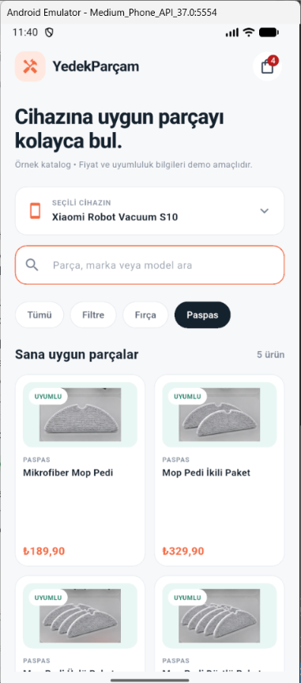
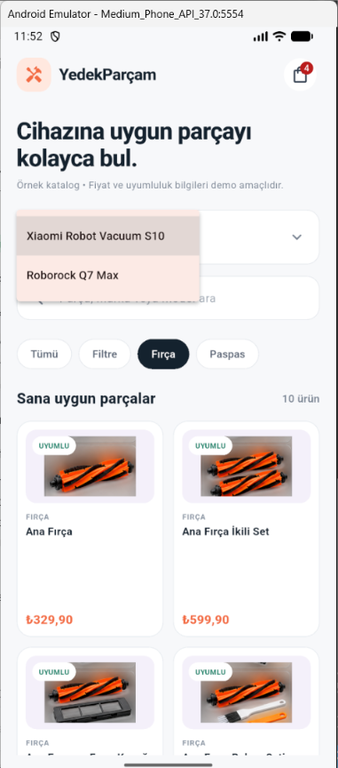
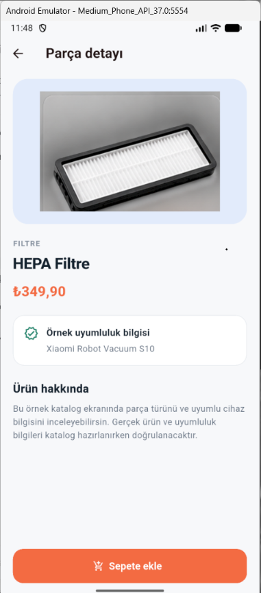
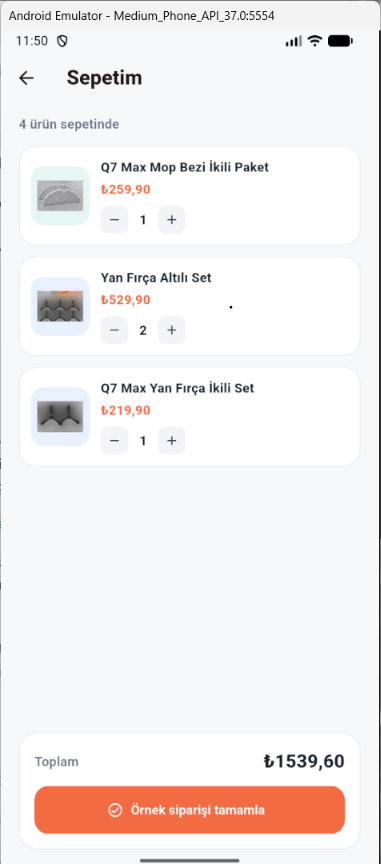

# YedekParçam

YedekParçam, robot süpürgeler için yedek parça ve aksesuarların listelenebildiği Flutter tabanlı bir mobil katalog uygulamasıdır.

Bu projeyi geliştirirken Xiaomi Robot Vacuum S10 ve Roborock Q7 Max modellerine ait yedek parçaları kullanıcıların inceleyebileceği bir katalog oluşturmayı amaçladım.

## Proje Özellikleri

Projemde aşağıdaki özellikleri geliştirdim:

- Ürün kataloğu ve ürün listeleme
- Xiaomi Robot Vacuum S10 için 20 ürün
- Roborock Q7 Max için 5 ürün
- JSON dosyasından ürün verilerini okuma
- Ürün arama ve kategori filtreleme
- Cihaza göre ürün filtreleme
- Ürün detay sayfası
- Named Routes ile sayfa geçişleri
- Route Arguments ile sayfalar arasında veri aktarımı
- Sepete ürün ekleme
- Sepette ürün miktarını artırma ve azaltma
- Toplam fiyat hesaplama
- Ürün görsellerini yerel assets klasöründen yükleme

## Kullandığım Teknolojiler

- Flutter: 3.47.9
- Dart SDK: ^3.13.7
- Material Design 3
- JSON veri yapısı

## Kullandığım Paketler

- flutter
- cupertino_icons
- flutter_lints (geliştirme bağımlılığı)

## Proje Klasör Yapısı

```text
yedek_parcam/
│
├── assets/
│   ├── data/
│   │   └── spare_parts.json
│   │
│   └── images/
│
├── lib/
│   ├── data/
│   │   ├── part_data.dart
│   │   └── sample_parts.dart
│   │
│   ├── models/
│   │   └── spare_part.dart
│   │
│   ├── screens/
│   │   ├── cart_screen.dart
│   │   └── product_detail_screen.dart
│   │
│   └── main.dart
│
├── pubspec.yaml
└── README.md
```

## Kurulum

Projeyi bilgisayarınıza indirdikten sonra proje klasöründe terminal açarak aşağıdaki adımları uygulayabilirsiniz.

Öncelikle bağımlılıkları yükleyin:

```bash
flutter pub get
```

Ardından uygulamayı çalıştırın:

```bash
flutter run
```

## Veri Kaynağı

Ürün bilgilerinin yönetimini JSON dosyası üzerinden gerçekleştirdim. Ürün bilgileri `assets/data/spare_parts.json` dosyasında tutulmaktadır.

Ürün görsellerini ise `assets/images/` klasöründen yükleyecek şekilde düzenledim.

Uygulamayı eğitim ve demo amacıyla geliştirdim. Bu nedenle mevcut sürümde gerçek ödeme, canlı sipariş veya üretim ortamında çalışan bir e-ticaret altyapısı bulunmamaktadır.


## Ekran Görüntüleri

### Ana Sayfa


### Cihaz ve Kategori Filtreleme


### Ürün Detay Sayfası


### Sepet


## Geliştirme Amacım

Bu projeyi Flutter ile mobil uygulama geliştirme eğitimi kapsamında öğrendiğim konuları uygulamaya geçirmek amacıyla geliştirdim.

Proje sürecinde widget kullanımını, JSON veri yönetimini, model sınıflarını, sayfa yönlendirmeyi, sayfalar arasında veri aktarımını ve temel durum yönetimini uygulamalı olarak kullandım.

## Gelecek Geliştirme ve Ticarileştirme Planım

YedekParçam'ı yalnızca eğitim kapsamında geliştirilmiş bir mobil katalog uygulaması olarak bırakmak istemiyorum. İlerleyen aşamalarda projeyi gerçek bir yedek parça satış platformuna dönüştürmeyi hedefliyorum.

Mevcut sürümde ürünleri JSON dosyasından okuyacak şekilde hazırladım. Kullanıcılar ürünleri inceleyebiliyor, arama ve kategori filtreleme yapabiliyor ve demo sepetine ürün ekleyebiliyor.

### Gelecekte Planladığım Geliştirmeler

### 1. Backend ve API Entegrasyonu

- JSON tabanlı ürün verilerini merkezi bir veritabanına taşımayı planlıyorum.
- Mobil uygulamanın REST API üzerinden veri alışverişi yapmasını hedefliyorum.
- Ürün, kategori ve marka bilgilerinin dinamik olarak yönetilmesini planlıyorum.

### 2. Yönetim Paneli

- Şirket yetkililerinin ürün ekleyip düzenleyebileceği bir yönetim paneli geliştirmeyi hedefliyorum.
- Fiyat ve stok bilgilerinin güncellenebilmesini planlıyorum.
- Siparişlerin yönetilebileceği bir sistem oluşturmayı düşünüyorum.

### 3. Kullanıcı ve Üyelik Sistemi

- Kullanıcı kayıt ve giriş işlemlerini eklemeyi planlıyorum.
- Kullanıcı profili ve adres yönetimi özelliklerini geliştirmeyi hedefliyorum.
- Kullanıcıların sipariş geçmişini görüntüleyebilmesini istiyorum.

### 4. Gerçek E-Ticaret Altyapısı

- Gerçek sipariş oluşturma sistemini geliştirmeyi planlıyorum.
- Güvenli ödeme sistemi entegrasyonu yapmayı hedefliyorum.
- Kargo ve sipariş takip sistemini eklemeyi düşünüyorum.
- Stok kontrolü ve sipariş durumlarının yönetilmesini sağlamayı planlıyorum.

### 5. Ölçeklenebilir Ürün Altyapısı

- Sisteme yeni robot süpürge markaları eklenebilmesini hedefliyorum.
- Farklı cihaz modellerine göre yedek parça eşleştirmesi yapmayı planlıyorum.
- Ürün uyumluluk bilgilerinin merkezi olarak yönetilmesini istiyorum.

### Uzun Vadeli Hedefim

Uzun vadede YedekParçam'ı robot süpürge kullanıcılarının cihazlarına uygun yedek parçaları kolayca bulabildiği, şirketlerin ürün ve stok yönetimini gerçekleştirebildiği ve gerçek satış süreçlerinin yürütülebildiği kapsamlı bir mobil ticaret platformuna dönüştürmek istiyorum.

**Not:** Bu bölümde belirttiğim özellikler mevcut sürümde uygulanmamıştır. Bunlar projenin gelecekteki geliştirme ve ticarileştirme hedefleridir.